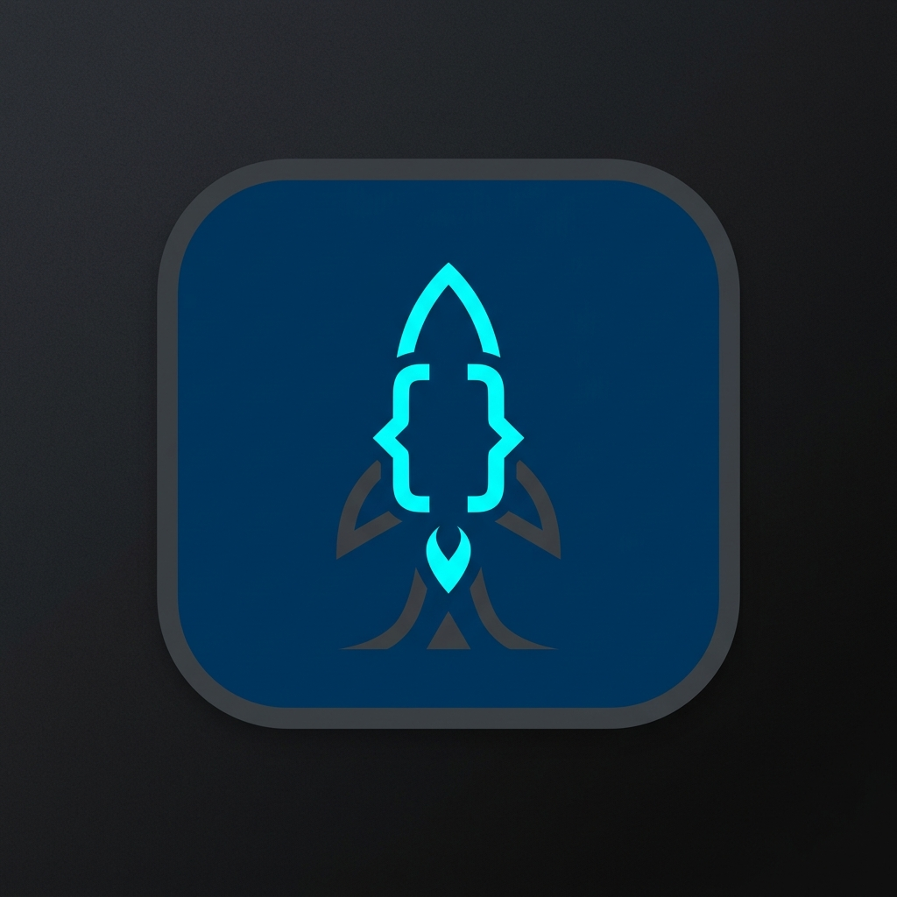
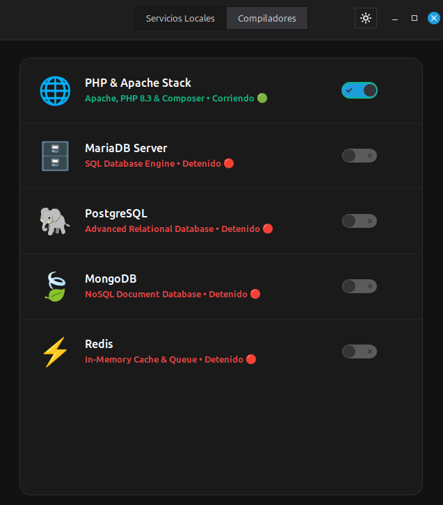
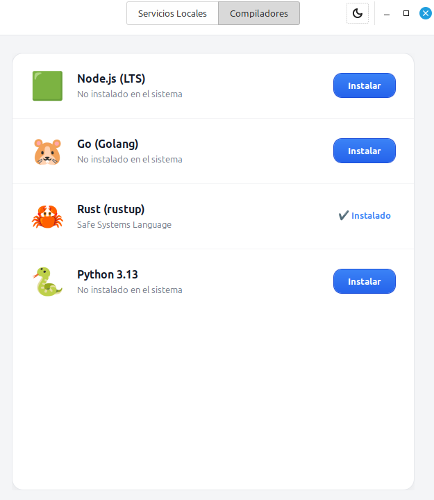

# DevManager 🚀

Un gestor e instalador de entornos de desarrollo local increíblemente rápido, elegante y moderno para Linux (Ubuntu/Mint/Debian). Olvídate de configuraciones interminables en la terminal; instala y gestiona tus lenguajes y bases de datos con un solo clic.

Es la alternativa definitiva y Open Source a herramientas de pago como Laravel Herd, Valet o DBngin, construida nativamente para Linux con Python y GTK3.

<p align="center">
  
</p>

## 📸 Interfaz

DevManager cuenta con soporte nativo para Tema Oscuro y Tema Claro, adaptándose a tu flujo de trabajo.

| Modo Oscuro (Servicios) | Modo Claro (Compiladores) |
|:---:|:---:|
|  |  |

## ✨ Características

- **Diseño Nativo y Elegante:** Interfaz moderna, rápida y con soporte para bandeja del sistema (System Tray).
- **Instalación de un Clic:** Instala las versiones "Current LTS" de las herramientas más demandadas sin tocar la terminal.
- **Gestión Inteligente:** Detecta automáticamente qué tienes instalado en tu sistema.
- **Pestañas Separadas:**
  - **Servicios Locales:** Apache & PHP 8.3, MariaDB, PostgreSQL, MongoDB, Redis.
  - **Compiladores:** Node.js 22, Go (Golang), Rust (Rustup), Python 3.13.

## 📦 Requisitos Previos

Dado que DevManager usa la tecnología nativa de ventanas de Linux (GTK3), asegúrate de tener las librerías base instaladas. Abre tu terminal y ejecuta:

```bash
sudo apt update
sudo apt install -y python3-gi gir1.2-gtk-3.0 gir1.2-vte-2.91 gir1.2-ayatanaappindicator3-0.1 git
```

## 🚀 Instalación Automática

1. Clona este repositorio en tu computadora:
```bash
git clone https://github.com/rodewdev/apache-linux-panel-gui.git
cd apache-linux-panel-gui
```

2. Ejecuta el instalador mágico:
```bash
sudo ./install.sh
```

¡Eso es todo! Ahora puedes buscar **"DevManager"** en el menú de aplicaciones de tu sistema, o anclarlo a tu barra de tareas.

## 🔄 Actualizaciones

DevManager cuenta con un botón nativo en la bandeja del sistema (clic derecho en el ícono de la barra de tareas > "Actualizar DevManager") que bajará las últimas mejoras automáticamente desde GitHub.

## 🤝 Contribuciones y Open Source

Este proyecto es 100% libre bajo la licencia **MIT License**. Si te gusta, ¡déjanos una estrellita ⭐ en GitHub! Las contribuciones de la comunidad son súper bienvenidas.
